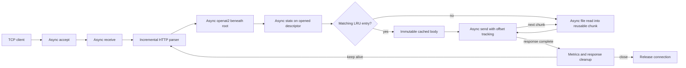

# Architecture and ownership

## Components

- `src/config.*`: validated runtime configuration.
- `src/http.*`: transport-independent request framing, URI decoding, MIME lookup,
  and HTTP response headers.
- `src/cache.hpp`: payload-bounded LRU with immutable shared bodies and file versions.
- `src/server.cpp`: file descriptor ownership, ring submission/completion,
  connection state, buffers, deadlines, logging, and metrics.

The main process has one event loop and no application worker threads. The
kernel may use its own workers to execute asynchronous filesystem operations.
Application-level scalability across multiple CPU cores is deferred.

## Connection lifecycle

1. Accept a socket, create a connection, and issue one receive.
2. Accumulate fragmented headers up to the configured limit. A complete header
   produces either an explicit error response or a validated GET/HEAD request.
3. Decode the URI and issue openat2 relative to an already-open document root.
   `RESOLVE_BENEATH` enforces containment during lookup, including concurrent
   symlink changes. `O_NONBLOCK` prevents a FIFO open from blocking before it can
   be rejected as nonregular.
4. Stat the opened descriptor asynchronously. Metadata validates the cache and
   fixes the response Content-Length. HEAD sends headers only.
5. Send a cached body or alternate bounded asynchronous file reads and socket
   sends. Every short transfer updates an offset before resubmission. A file
   shrinking before the promised length completes causes connection closure.
6. A newly gathered cache body is inserted only after metadata is checked again.
   Complete the request metrics, release the file and body references, then
   parse any pipelined bytes or issue the next receive.

One connection has at most one original operation outstanding. Many different
connections can have outstanding operations simultaneously. Cancellation SQEs
are separate and can coexist with the original operation.

## Memory and descriptor safety

Each SQE's user_data is a unique numeric operation identifier. An operation owns
a shared reference to its connection and stores any `open_how`/`statx` argument
structures. Connection-owned strings, receive arrays, and file chunks remain
stable until the corresponding completion.

On timeout, the server marks the connection closing, shuts down its socket, and
submits a cancellation by operation identifier. It retains buffers and file
descriptors until the original CQE arrives. A successful open racing with
cancellation has its returned descriptor closed explicitly. Cancellation CQEs
never substitute for the original operation's completion.

Closing connections continue counting against the connection limit until that
completion. This prevents repeated timed-out operations from bypassing the
limit. On an exception, the ring is torn down before operation and connection
objects are destroyed.

The file buffer pool grows to the maximum number of simultaneously needed
chunks and reuses them. A cache candidate has a configured per-file cap; the
LRU has a configured resident payload cap. In-flight responses can retain
an evicted body, so total payload memory may exceed the LRU's resident cap.
Input can contain one receive-sized amount beyond the header limit before
parsing rejects it; pipelined requests are processed sequentially.

## Batching and backpressure

SQEs accumulate while completions are drained, up to `--batch-size` or queue
capacity. They are flushed before the event loop blocks. A batch size of 1
submits each operation immediately and provides the comparison baseline.
Queue depth controls submission ring size, not total accepted connections.

At the configured connection limit, accepts pause; excess TCP connections wait
in the kernel backlog or are rejected by the network stack when it fills. File
reads advance only after the previous socket chunk has been sent, providing
bounded application buffering for slow readers.

## Cache consistency

Every lookup opens and stats the actual file, even for a cache hit. Cache keys
are normalized relative paths. Versions include device, inode, size, and
nanosecond modification/change times. Replacements and ordinary writes therefore
invalidate cached bodies. Empty and oversized files bypass the cache.

This is metadata validation rather than a filesystem snapshot. Atomic file
replacement gives the clearest behavior: an existing open descriptor completes
its old version, and later opens see the replacement. In-place concurrent writes
can affect already streaming bytes; the post-read check prevents that body
from being inserted when metadata changed.

## Shutdown

SIGINT/SIGTERM handlers only set a signal-safe flag. The loop cancels accept,
closes idle connections, and lets active responses finish. At the grace
deadline it cancels remaining operations, then drains completions. Kernel work
that cannot promptly be cancelled can extend the shutdown time; releasing its
memory early would be unsafe.
