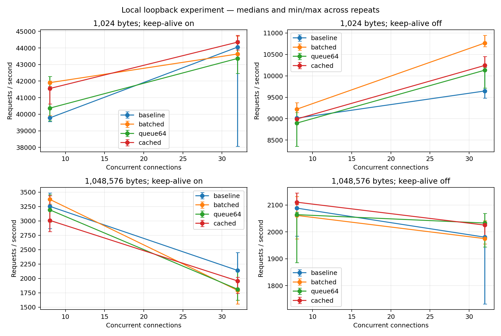
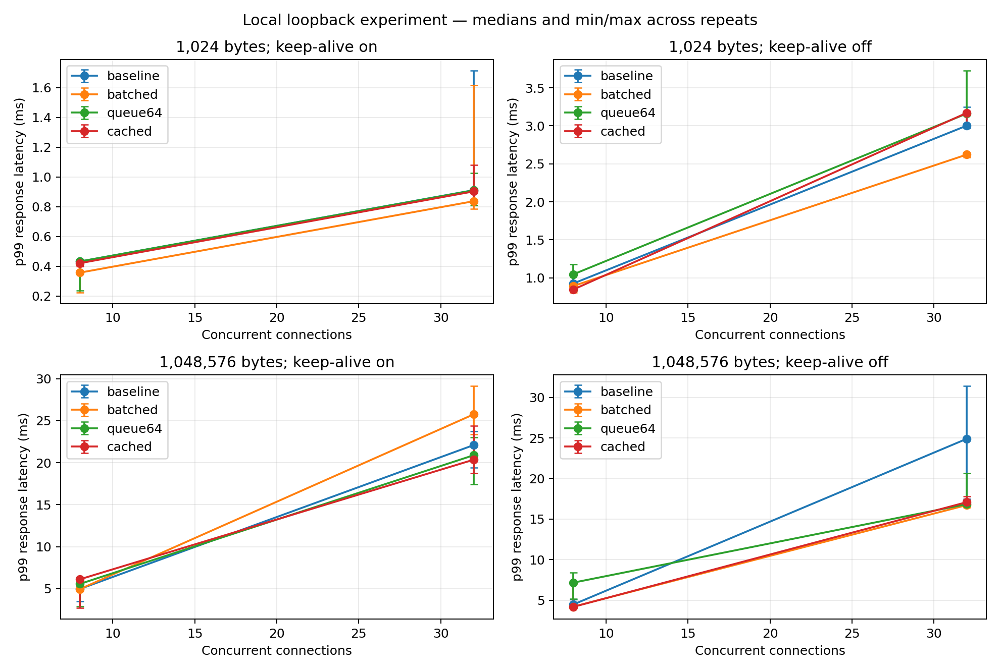

# Findings from the recorded local experiment

The recorded matrix has 96 runs: four profiles × two file sizes × two concurrency
levels × keep-alive on/off × three repeats. Each measured interval lasts about
one second after 0.2 seconds of warmup. These are short exploratory measurements.
The measured build uses GCC 13.3, C++17, RelWithDebInfo (`-O2 -g -DNDEBUG`).

## Correctness and resource observations

- No measured HTTP/transport failures occurred. Final server counters across
  warmup and measurement also report zero HTTP errors, I/O errors, and timeouts.
- All final snapshots have zero active connections. Across warmup and measured
  periods, 1,605,092 server requests completed.
- Executable peak RSS ranges from 4,420 to 6,504 KiB in this matrix. These figures
  describe the chosen 8/32-connection workloads, not memory use at the configured
  maximum connection count or with a fully populated cache.

## What changed under optimization

For a 1 KiB file and 32 persistent connections, median throughput is about
44,053 requests/s for baseline and 44,352 requests/s for cached. The repeat ranges
overlap, so these runs do not establish a throughput improvement from caching.
Median server CPU is about 78.9% of one core for baseline and 75.9% for cached.
The cache counters and file-read counts provide direct evidence that repeated
body reads are avoided; metadata lookup still occurs on every request.

For a 1 MiB file and eight persistent connections, batching increases operations
per submission from 1.00 to about 5.09. Median throughput is about 3,253 requests/s
for baseline and 3,375 for batched, with overlapping repeat ranges. This supports
a reduction in submission calls, but a stable throughput benefit needs stronger
measurements.

At 32 persistent connections with a 1 MiB file, batched median throughput is
lower than baseline (about 1,791 versus 2,138 requests/s). Batching therefore
should not be presented as universally faster. Queue-depth and batching choices
must be evaluated against the actual workload and tail latency.

Keep-alive has a visible effect in these local runs. For the baseline 1 KiB
workload at 32 connections, median throughput is about 44,053 requests/s with
persistence and 9,646 without it. Connection setup is included in the latter
client latency measurement.

## Limits on conclusions

The Python generator consumes approximately a full core (its CPU/wall ratio
ranges from 0.987 to 1.004). It is a likely bottleneck, particularly for small
files. Increasing server concurrency cannot overcome a saturated generator.
The generator shares the host, so observed CPU scheduling and copy costs affect
both sides. Closed-loop latency omits independent-arrival queueing delay.

Do not extrapolate these numbers to internet traffic, cold storage, multicore
scaling, or a claim that io_uring outperforms epoll. The next evaluation should
use longer runs and an independent, separately hosted load generator. Consult
`benchmark-results/results.csv` and the raw metrics rather than selecting only
favorable runs.

